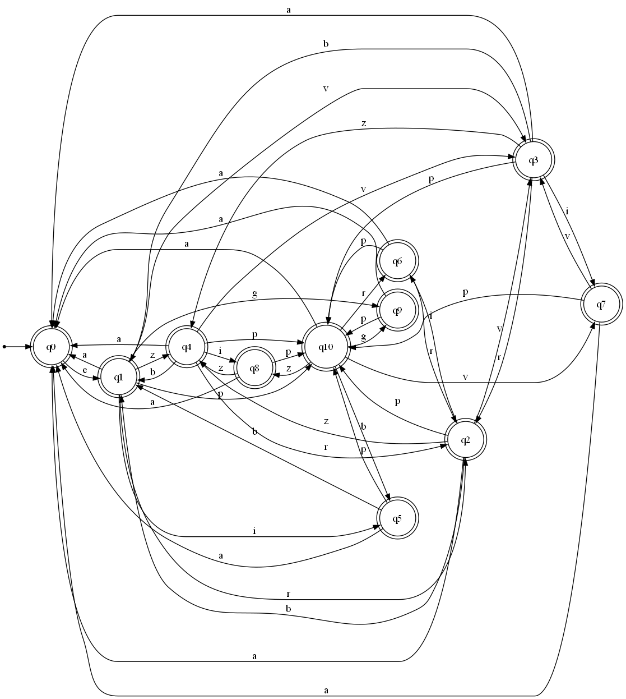

## Trabajo Práctico: Control de Iluminación Inteligente con Autómatas (FTI)

# Control de Iluminación Inteligente con Autómatas (FTI)

Proyecto desarrollado para la cátedra **Fundamentos Teóricos de Informática (FTI)**. 

El sistema modela y simula el funcionamiento de una tira de luces LED inteligente mediante la teoría de autómatas, implementando un **Autómata Finito Determinístico (AFD)** y una **Máquina de Moore** (donde las salidas visuales dependen exclusivamente del estado actual del sistema).
FALTA LA PARTE DE PILA.

---

## Integrantes

* **Lucas Ruiz**
* **Jordan Sandoval Molina**
* **Matias Segurado**

---

## Novedades y Actualizaciones Recientes

* **Modelado como Máquina de Moore:** Cada estado tiene asociada una salida visual unívoca (color, intermitencia, modo dinámico RGB o apagado).
* **Nueva Interfaz Gráfica de Escritorio (Tkinter):** Permite interactuar con la tira LED en tiempo real mediante botones y observar las transiciones de estado en vivo (`interfaz_luces.py`).
* **Simulador Web Interactivo:** Prototipo visual en navegador (`simulador_tira_led_moore.html`) con efectos de iluminación CSS/Canvas.
* **Soporte y Diagramación:** Definición formal en Python con `automata-lib`, diagrama visual exportado (`diagrama.png`) y archivo de modelado para JFLAP (`automata_Proyecto_Grupo8.jff`).

---

## Descripción del Sistema

El sistema simula el funcionamiento de una tira LED inteligente hogareña controlada por eventos/comandos:

* **Encendido y Apagado:** Control general de energía.
* **Colores estáticos:** Blanco, Rojo, Verde y Azul.
* **Modos Intermitentes:** Parpadeo individual para cada uno de los colores.
* **Modo Dinámico:** Efecto arcoíris / gradiente continuo (RGB).
* **Parada / Pausa (`p`):** Regreso o cambio de flujo entre modos.
* **Falta Pila**
---

## Especificación Formal de la Máquina

### 1. Conjunto de Estados ($Q$)
* **`q0`**: Apagado (OFF)
* **`q1`**: Blanco estático
* **`q2`**: Rojo estático
* **`q3`**: Verde estático
* **`q4`**: Azul estático
* **`q5`**: Blanco intermitente
* **`q6`**: Rojo intermitente
* **`q7`**: Verde intermitente
* **`q8`**: Azul intermitente
* **`q9`**: Modo RGB Dinámico (Arcoíris)
* **`q10`**: Estado de transición / Pausa

### 2. Alfabeto de Entrada ($\Sigma$)
* `e`: Encender
* `a`: Apagar
* `b`: Blanco
* `r`: Rojo
* `v`: Verde
* `z`: Azul
* `i`: Modo Intermitente
* `g`: Modo RGB / Arcoíris
* `p`: Parar / Cambiar modo

### 3. Salidas de la Máquina de Moore ($\Delta$)
Cada estado genera un comportamiento visual en la tira LED:
* `q0` $\rightarrow$ Luz apagada
* `q1` a `q4` $\rightarrow$ Color fijo correspondiente
* `q5` a `q8` $\rightarrow$ Animación intermitente del color
* `q9` $\rightarrow$ Ciclo dinámico multicolor

---

## Requisitos e Instalación

El proyecto requiere **Python 3.10+**.

### 1. Clonar el repositorio
```bash
git clone <URL_DEL_REPOSITORIO>
cd Trabajo-Fti-1
```

### 2. Instalar dependencias
```bash
pip install automata-lib
```

*(Opcional) Si deseas regenerar `diagrama.png` usando Graphviz:*
```bash
pip install "automata-lib[visual]"
```

---

## 🖥️ Modos de Ejecución

### 1. Interfaz Gráfica (Python / Tkinter)
Ejecuta la simulación interactiva con tablero de control y visualización de la tira LED:
```bash
python interfaz_luces.py
```

### 2. Consola / Validación Teórica
Para verificar la lógica del autómata por terminal o procesar cadenas de prueba:
```bash
python luces.py
```

### 3. Simulador Web
Abre directamente en tu navegador preferido el archivo:
```text
simulador_tira_led_moore.html
```

### 4. Simulación en JFLAP
Puedes abrir el archivo "automata_Proyecto_Grupo8.jff" en **JFLAP** para realizar pruebas de cadenas paso a paso y visualizar la estructura de transiciones.

---

## 📊 Diagrama del Autómata

Grafico del Diagrama actual:
